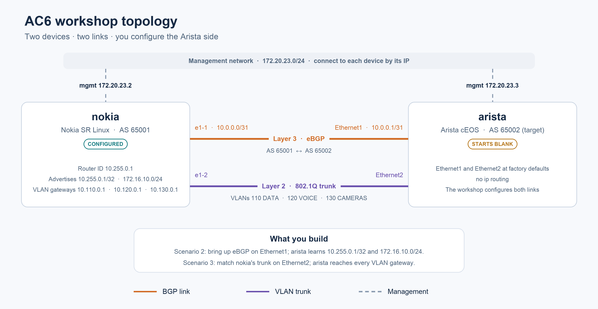

# Run the workshop locally with Docker

The same eight-node topology runs locally: SR Linux at JFK and `rtr-ewr`,
cEOS at IAD and `rtr-phl`, and Linux clients at both sites.



## Prepare

Install Git, Docker, `just`, GitHub CLI (`gh`), and a native `stcli` binary.
Allocate **4 CPU cores / 16 GB RAM** to the lab machine. On macOS, use
OrbStack and allocate these resources to its Linux VM. On Linux, use
Docker Engine on a machine with these resources. The cEOS package
supports both AMD64 and ARM64; Docker selects your native architecture.

Authenticate GitHub CLI with an account that can access this repository
and its private container package:

```sh
gh auth login
gh auth refresh --scopes read:packages
gh repo clone super-trace/ac6-workshop-lab
cd ac6-workshop-lab
gh auth token | docker login ghcr.io -u "$(gh api user --jq .login)" --password-stdin
just lab-setup
```

`lab-setup` pulls the network OS images, builds the Linux client image,
and installs the shared lab key and SSH aliases under `~/.ssh/`.
It does not install the Linux-only bundled `stcli` on your computer.
The containerlab helper requires privileged Docker access.

## Start and check

```sh
just lab-up
just verify
```

Wait for startup configuration to finish. Expect Full OSPF neighbors,
Established BGP sessions, successful client pings, and SSH access to all
nodes. Initial image downloads and device startup can take several minutes.

## Connect

```sh
stcli login
stcli spine-jfk
```

Other targets: `leaf-jfk`, `client-jfk`, `spine-iad`, `leaf-iad`,
`client-iad`, `rtr-phl`, and `rtr-ewr`. For a native CLI, run
`just lab-cli rtr-ewr`. List all commands with `just --list`.

## Finish

```sh
just lab-down
just cleanup-ssh
```

Do not run a Codespace port-forwarding tunnel while the local lab is
running: both use SSH ports 2401–2408 on your computer.
