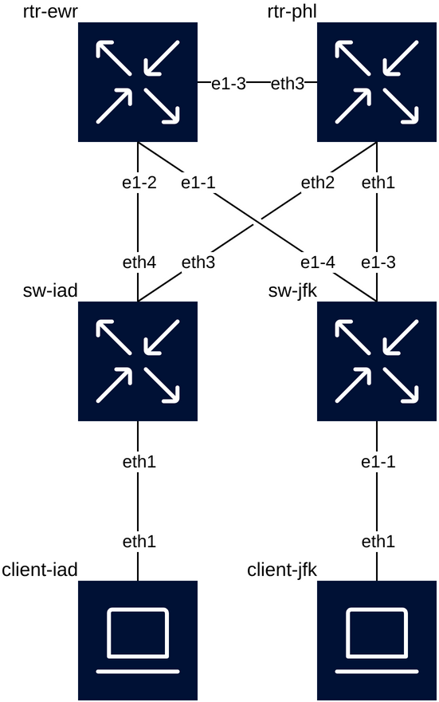

# AC6 workshop lab — "Old Protocol, New Brain"

The containerlab environment for the AC6 workshop spec
(`../../specs/conferences/ac6-workshop-submission.md`): every attendee gets
their own copy of this lab, connects to it with `stcli`, and troubleshoots a
BGP fault (guided) and an MTU fault (self-serve), with a small menu of extra
faults for the "choose your own" segment.

## Contents

- [Running the lab](#running-the-lab)
- [Why SR Linux + FRRouting](#why-sr-linux--frrouting-not-junoscrpd-or-aristaceos)
- [Topology](#topology)
- [Scenarios](#scenarios)
- [Known SR Linux / containerlab quirks](#known-sr-linux--containerlab-quirks)
- [Codespaces details](#codespaces-details)

## Running the lab

One-time, either mode: `stcli login` (real backend, nothing to stand up
locally), and add this to `~/.ssh/config`:

```
Include /path/to/this/repo/lab/ssh_config
```

### Codespaces (recommended — no local Docker needed)

1. On GitHub: **Code → Codespaces → Create codespace on main.** Setup runs
   automatically.
2. In the Codespace's own terminal (VS Code, or `gh codespace ssh`):
   ```sh
   just lab-up
   ```
3. On your own machine, in a terminal you leave running:
   ```sh
   just codespace-connect
   ```
4. In another terminal on your own machine:
   ```sh
   stcli spine-jfk   # or any of the 8 nodes — see Node roles below
   ```

Local and Codespace-hosted can't run at the same time on one machine (same
ports) — `just lab-down` first if you've been running locally. More on
why, and on the Codespaces-specific pitfalls, in
[Codespaces details](#codespaces-details) below.

### Locally

Needs Docker (or OrbStack on macOS) and `just`.

```sh
just lab-setup
just lab-up
stcli spine-jfk
```

### Either way

- One device per `stcli` session — open a second terminal tab for another device.
- `just verify` — the full OSPF/BGP/reachability check.
- `just lab-cli <node>` — native CLI (`sr_cli`/`vtysh`/`sh`), independent of `stcli`.
- `just break <scenario>` / `just fix <scenario>` — see [Scenarios](#scenarios).
- Something looks wrong? `just lab-down && rm -rf lab/clab-ac6-workshop &&
  just lab-up` — see [Known quirks](#known-sr-linux--containerlab-quirks)
  for why the `rm -rf` matters.
- Running locally with a tight memory budget? A 12-node version of this
  topology OOM-killed SR Linux under a ~12GiB VM limit — see
  [Known quirks](#known-sr-linux--containerlab-quirks). The current 8-node
  shape fits comfortably.

## Why SR Linux + FRRouting, not Junos/cRPD or Arista/cEOS

This has to work for an unknown number of strangers spinning up their own
environment with no sales process and no account beyond a free one on
`ssh.supertrace.ai`. That ruled out the platforms used in this org's other
labs:

- **Juniper cRPD** needs a license to run BGP or ISIS at all — confirmed
  directly (`Idle (LicenseFailure)`, zero packets exchanged) while building
  the sibling `stcli-3node-lab` repo. Not something a workshop attendee can
  get themselves.
- **Arista cEOS** needs a licensed tar file from Arista's site, imported
  locally per machine. Same problem, worse at scale.

**SR Linux** is a genuinely native container, pullable from a public
registry with no account. **FRRouting** is Apache-2.0 and plays both WAN
routers. Both are free, both are fast to boot, and neither needs anything
attendees don't already have.

## Topology

Two independent sites (JFK, IAD), each a single-spine Clos — spine, one
leaf, one client — connected by a small WAN core of two FRR routers
(`rtr-phl`, `rtr-ewr`) that gives the sites two independent paths, plus a
direct link between the WAN routers for a third form of resilience.



This image is generated, not hand-drawn — `just lab-diagram` turns the real
`topology.clab.yml` into it via containerlab's own `graph --drawio` (through
the [clab-io-draw](https://github.com/srl-labs/clab-io-draw) project, which
supplies the router/switch/host icons) and
[rlespinasse/drawio-desktop-headless](https://github.com/rlespinasse/docker-drawio-desktop-headless)
to render a static PNG, since GitHub doesn't render `.drawio` natively. Run
it after any topology change — nothing keeps this image in sync
automatically. The source `lab/topology.clab.drawio` is also committed and
editable at [app.diagrams.net](https://app.diagrams.net) if you want to
touch it up by hand. Each node's position in the diagram comes from
`labels.graph-level`/`graph-icon` in `topology.clab.yml`, not from
containerlab itself — worth knowing if a node ever lands somewhere odd after
adding one.

For a quick, icon-free structural sanity check instead (does the real
topology still match what's documented, with no Docker image pulls beyond
what's already needed to run the lab), use `just lab-graph` — wraps
containerlab's `graph --dot`, needs `graphviz` locally
(`brew install graphviz`).

### Protocol layering: OSPF underlay, BGP everywhere above it

Each site runs OSPF internally (area 0.0.0.0), carrying only the
point-to-point link and both devices' loopbacks — no client subnets, no BGP
routes. On top of that underlay, the spine and leaf peer **iBGP, loopback to
loopback** (both share the site's AS: 65010 for JFK, 65030 for IAD), and the
spine peers **eBGP** with both WAN routers. The two WAN routers and the two
spines sit in four distinct ASes (65010/65021/65022/65030); `rtr-phl` and
`rtr-ewr` also peer eBGP with each other, not an iBGP mesh with no IGP
underneath it.

This deliberately doesn't go full eBGP-only per
[RFC 7938](https://datatracker.ietf.org/doc/html/rfc7938) (the
Facebook/Microsoft large-DC design, which argues for eBGP absolutely
everywhere with no IGP at all) — the workshop spec needs an OSPF scenario,
and an IGP-free fabric would delete the only thing left to break for it.
What it does borrow from RFC 7938 and real DCI practice is running BGP at
every tier, including spine-leaf, rather than letting OSPF carry anything
beyond the underlay.

The spine's iBGP group toward the leaf sets **next-hop-self**, and this one
*is* load-bearing, not redundant config hygiene: without it, the leaf would
receive the WAN-learned routes with their original eBGP next-hop (a
`172.16.x.x` address on a link the leaf has no path to at all), and
next-hop resolution would fail silently. With it, the leaf resolves
everything through the spine's own loopback, which OSPF already carries.

### Node roles

| Node | Role | Kind | AS | stcli target? | Mgmt SSH port |
|---|---|---|---|---|---|
| `spine-jfk` | JFK's only spine; OSPF + iBGP to `leaf-jfk`, eBGP to both WAN routers | SR Linux | 65010 | **yes** | 2401 |
| `leaf-jfk` | JFK's only leaf; OSPF + iBGP to `spine-jfk`, customer LAN to `client-jfk` | SR Linux | 65010 | **yes** | 2402 |
| `client-jfk` | JFK customer traffic source/sink | plain Linux | — | **yes** | 2403 |
| `spine-iad` | IAD's only spine, mirrors `spine-jfk` | SR Linux | 65030 | **yes** | 2404 |
| `leaf-iad` | IAD's only leaf, mirrors `leaf-jfk` | SR Linux | 65030 | **yes** | 2405 |
| `client-iad` | IAD customer traffic source/sink | plain Linux | — | **yes** | 2406 |
| `rtr-phl` | WAN router, path 1 | FRRouting | 65021 | **yes** | 2407 |
| `rtr-ewr` | WAN router, path 2 | FRRouting | 65022 | **yes** | 2408 |

Every node is an stcli target — unlike the old single-site version of this
lab, there's no "supporting cast, `docker exec` only" tier. Every node also
accepts key-based login with no password prompt: `just lab-setup` installs
a shared, non-secret lab keypair (`lab/ac6-workshop-key`) to
`~/.ssh/ac6-workshop-key`, matched by a public key baked into every node —
on SR Linux, as a new `stcli` local superuser (`admin` is a reserved
username there and can't take an `ssh-key`; see `lab/configs/spine-jfk.cfg`
for how that was found); on the Linux nodes, as `root`'s
`authorized_keys`, bind-mounted in from the same file. Interactive/manual
CLI access still falls back to passwords: SR Linux's factory-default
`admin` / `NokiaSrl1!`, and `root` / `admin` on the Linux clients and FRR
routers (set by `lab/images/*/Dockerfile`, since neither a stock Linux
container nor the stock `frrouting/frr` image ships an SSH server at all).

The spine redistributes the leaf's client subnet into its eBGP sessions via
an **explicit allow-list** (`routing-policy prefix-set advertised`), not a
broad match-everything policy, specifically so Scenario 1 can break *one*
prefix's advertisement with a single config line. The leaf learns *remote*
sites' subnets the other direction, over its iBGP session to the spine —
the spine's eBGP-learned routes flow straight into that iBGP session with
their next-hop rewritten to the spine's own loopback (next-hop-self, see
above), no redistribution into OSPF needed.

## Scenarios

| # | Name | Pace | Break | Fix |
|---|---|---|---|---|
| 1 | BGP: a prefix stops being advertised | guided | `just break bgp` | `just fix bgp` |
| 2 | MTU: breaks some traffic, not all of it | self-serve | `just break mtu` | `just fix mtu` |
| 3 | OSPF: adjacency stuck at Two-Way | menu | `just break ospf` | `just fix ospf` |
| 4 | WAN: one of the two inter-site paths goes down | menu | `just break wan` | `just fix wan` |

### 1. BGP: a prefix stops being advertised (guided)

Removes `192.168.11.0/24` (`client-jfk`'s subnet) from `spine-jfk`'s export
allow-list.

**Symptom:** `spine-iad`'s BGP table loses `192.168.11.0/24` (check with
`just lab-cli spine-iad` → `show network-instance default protocols bgp
routes ipv4 prefix 192.168.11.0/24`); `leaf-jfk`'s loopback stays advertised,
since this is a single allow-list entry, not a whole-policy or
whole-session break. Diagnosable and fixable entirely from `spine-jfk`.

### 2. MTU: breaks some traffic, not all of it (self-serve)

Raises `client-jfk`'s own interface MTU to 9500, above what the WAN link
(`leaf-jfk`'s `ethernet-1/2`, fixed at SR Linux's 1500 floor) can carry —
"the customer's device has jumbo frames misconfigured."

**Symptom:** `ping -s 200` succeeds, `ping -s 3000` silently vanishes — no
ICMP error, nothing wrong-looking in any routing table or adjacency on
either router. That's the point: the fault lives entirely on the customer's
own device, so there's nothing router-side to "discover" except by actually
testing different packet sizes end to end.

### 3. OSPF: a fabric link stuck at Two-Way (menu)

Removes the `interface-type point-to-point` override on `leaf-jfk`'s side of
the `leaf-jfk`↔`spine-jfk` link — the site's only fabric link.

**Symptom:** the adjacency never reaches Full; `show network-instance
default protocols ospf neighbor` on `leaf-jfk` shows it stuck at `two-way`.
SR Linux treats the link as broadcast-type (needing DR/BDR election) without
the override, and on a true point-to-point veth with no real election
outcome, it just never finishes. Hit by accident during development, kept on
purpose — it's a classic, very real OSPF gotcha with zero error messages
anywhere.

Unlike Scenario 4, this one is a **full outage** for `client-jfk` — this
site has only one leaf, so there's no second path to fail over to. That's
deliberate: the "still reachable, just less redundant" story lives at the
WAN tier instead, where a real 2-path design actually has a second path.

### 4. WAN: one of the two inter-site paths goes down (menu)

Shuts `spine-jfk`'s link to `rtr-phl`.

**Symptom:** that BGP session drops to `active`; JFK's traffic shifts
entirely onto the `rtr-ewr` path. End-to-end reachability **survives this
one** — a good prompt for attendees to notice "nothing is broken" isn't the
same question as "is anything still redundant." Check both of `spine-jfk`'s
eBGP sessions, not just a ping, to see what actually changed.

## Known SR Linux / containerlab quirks

Found and worked around while building this — documented here so the next
person debugging a "why did this just break" moment doesn't start from zero.

**A 12-node version of this lab reliably OOM-killed SR Linux's own
forwarding process.** The first pass at this topology used 2 leaves + 2
clients per site (12 nodes total, 6 of them SR Linux). Every node came up
and `heal-fabric.sh` reported all of them healthy, but every interface
beyond the management port then reported `is down, reason port-not-present`
— on every SR Linux node, reproducible across multiple from-scratch
redeploys. `show system application` showed `xdp_lc_1` (SR Linux's
forwarding-plane process) in `error` state; the host kernel's own log
(`dmesg`) showed why: `Out of memory: Killed process ... (sr_xdp_lc)` inside
that node's container, on a Docker/OrbStack VM capped around 11.7GiB even
though the host had 24GiB physical RAM. `heal-fabric.sh`'s health check
(`show network-instance default interfaces` returning non-empty output)
didn't catch this — it returns content from whatever interfaces *did* come
up, so a partially-starved node can still look "healthy" by that check while
individual ports stay down. Fix was architectural, not a bigger timeout:
trim to 1 leaf + 1 client per site (8 nodes, 4 of them SR Linux). If you
raise your VM's memory limit well above the 12-node working set, scaling
back up should work fine — the failure was pure memory pressure, not
anything specific to node count.

**SR Linux rejects every received BGP route by default without an explicit
import-policy — eBGP and iBGP both.** Configuring only an `export-policy` on
a BGP group (the obvious mirror of FRR's `no bgp ebgp-requires-policy` fix,
below) is not enough — `show ... bgp neighbor <peer> detail` showed
`Received routes: 4, Rejected routes: 4` with `Import policies: []`, and the
route never reached the RIB even though the session was `established` and
the prefix showed up in `show ... bgp routes ipv4 summary`. Fixed with a
trivial catch-all policy (`routing-policy policy accept-all default-action
policy-result accept`) applied as the group's `import-policy` — every BGP
group in this lab needs one, spine-leaf iBGP included. Easy to miss because
the session looks completely healthy otherwise — Established, sending and
receiving updates, no error anywhere.

**BGP's default 120s connect-retry timer makes `scripts/break-wan.sh`'s fix
feel broken.** After the link flaps, both `spine-jfk` and `rtr-phl` can each
land in the other's "waiting to retry" window at a different point, so
re-enabling the link doesn't reconnect the session for up to two minutes —
long enough that it looks like the fix script failed. `scripts/break-wan.sh`
doesn't touch BGP timers directly, but `lab/configs/spine-jfk.cfg` and
`spine-iad.cfg` set `timers connect-retry 5` on the WAN BGP group, and
`lab/configs/rtr-*-frr.conf` set `timers connect 5` per neighbor, so a
break/fix cycle reconverges in seconds during a live demo instead of
minutes.

**Config checkpoints persist across `lab-down`/`lab-up`.** Containerlab
saves each SR Linux node's applied config to `lab/clab-ac6-workshop/<node>/`
and reuses it on redeploy instead of re-reading `startup-config` — by
design, so manual CLI changes survive a redeploy. If you've edited a
`configs/*.cfg` file, `just lab-down && just lab-up` **will not** pick up
the change; you need `rm -rf lab/clab-ac6-workshop` first.

**An SR Linux node's startup-config intermittently, silently failed to
apply — sometimes partially.** Confirmed repeatable at points during
development, independent of file content (isolated via a binary search:
identical lines succeeded reliably split across two smaller commits, failed
unpredictably as one big one) and independent of host memory pressure (seen
on a freshly-freed machine too, distinct from the OOM failure mode above).
Root cause not fully pinned down. Rather than keep refining a detector for
every way this can partially fail, `just lab-up` now runs
`scripts/heal-fabric.sh` after every deploy, which unconditionally
re-applies every SR Linux node's config in two commits — `set` commands are
idempotent, so reapplying something already correct is a no-op, not an
error.

**SR Linux's physical interface `mtu` and its logical subinterface's
`ip-mtu` are independent settings.** Raising only the physical interface's
`mtu` doesn't raise the MTU actually used for IP forwarding — you need both.
Changing `ip-mtu` live additionally left the subinterface stuck
`oper-state: down` in testing. This is why the MTU scenario lives on
`client-jfk` (plain Linux, one reliable `ip link set mtu` call) instead of
on `leaf-jfk`'s SR Linux interface — not worth the fragility when the same
mismatch is trivially reproducible from the other end of the link.

**FRR's RFC 8212 enforcement silently discards all routes on a "naked" eBGP
session.** `bgp ebgp-requires-policy` is on by default; without an explicit
route-map in both directions, FRR accepts the session but drops every
route, in both directions, with no error — every FRR BGP instance in this
lab disables it explicitly (`no bgp ebgp-requires-policy`).

**SR Linux's OSPF `match protocol` value is `ospfv2`, not `ospf`** in
routing-policy statements — an easy typo that fails the whole startup-config
commit with a (for once, actually helpful) parsing error.

**SR Linux's built-in `admin` account can't take an `ssh-key`.** `admin` is
a reserved system username; trying to set one anyway fails the commit with
`Reserved system usernames cannot be used for configured local users`, even
under the separate `system aaa authentication admin-user` path. Key-based
login needs a distinct local user (`stcli`, in this lab's configs) with
`superuser true`.

## Codespaces details

Commands for actually running Codespaces mode are in
[Running the lab](#running-the-lab) above — this is the "why" behind them.

`.devcontainer/` brings up Docker-in-Docker and installs `just` — nothing
proprietary needed (unlike `stcli-3node-lab`), so there's no licensed binary
to fetch from a release asset.

**`stcli` always runs on your own laptop, never inside the Codespace** — per
the workshop spec, the only thing attendees install locally is the `stcli`
binary itself. The Codespace just hosts the lab; its 8 SSH ports need to
reach back to your machine for `lab/ssh_config`'s `127.0.0.1`-based aliases
to work.

**Local and Codespace-hosted are mutually exclusive on one machine** — both
use the same canonical ports 2401-2408 through the same `lab/ssh_config`
aliases (that's what lets `stcli spine-jfk` etc. work identically either
way). If you've been running the lab locally, `just lab-down` first.

**Which commands run where**: `lab-setup`, `lab-up`, `lab-down`, `verify`,
`break`, `fix`, and `lab-cli` all talk to Docker directly — that only
exists inside the Codespace, so those run in *the Codespace's own
terminal* (VS Code, or `gh codespace ssh`). Only `stcli` itself and
`codespace-connect` run on your own machine.

`just codespace-connect` auto-detects the codespace if there's only one
(`just codespace-connect <name>` to name it explicitly — `gh codespace
list` to find it), checks that nothing local is already holding ports
2401-2408 (the local lab, almost always — it'll tell you to `just
lab-down`), installs the shared key locally if it isn't already, and holds
open a real TCP tunnel (`gh codespace ports forward`, mapping 2401-2408
1:1) in the foreground.

**Opening the Codespace in a browser tab is not enough** — GitHub's
browser-based port forwarding proxies forwarded ports over HTTPS, which
works for a web app but not for raw SSH. **VS Code Desktop's own
forwarding is also not recommended**, even though it's a genuine local TCP
tunnel rather than an HTTPS proxy: it silently *auto-offsets* every port
when something else is already holding them locally — confirmed firsthand,
2401-2408 became 2409-2416 with no error anywhere, which breaks
`lab/ssh_config`'s aliases in a way that's genuinely confusing to debug.
`gh codespace ports forward` (via `just codespace-connect`) doesn't have
this failure mode: it maps 1:1 or fails loudly.
