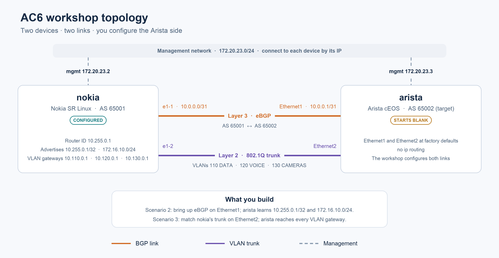

# AC6 workshop lab

An eight-node network lab for troubleshooting with `stcli`, running entirely
in GitHub Codespaces. JFK uses SR Linux; IAD uses Arista cEOS. The WAN
routers are cEOS (`rtr-phl`) and SR Linux (`rtr-ewr`); both clients use Linux.

For local Docker, follow [the local setup guide](README-docker-local.md).

> **Public launch:** This repository and `super-trace/stcli-releases` will both
> become public. At launch, update both READMEs, remove private-access requirements
> from the local-install instructions, and test downloads without GitHub login.



## 1. Create a Codespace

Open this repository on GitHub and select **Code → Codespaces → Create
codespace on main**. The repository requires a **4-core / 16 GB RAM**
machine, so smaller machine types aren't offered.

Wait for automatic setup to finish. It installs the lab images, `just`,
`stcli`, and SSH configuration.

## 2. Start and verify

In the Codespace terminal:

```sh
just lab-up
just verify
```

Expect OSPF neighbors to be Full, all WAN BGP peers to be Established,
and end-to-end client pings to succeed. Check the output for SSH failures.

## 3. Sign in

```sh
stcli login --headless
```

Open the verification link in your computer's browser, enter the one-time
code, and wait for **Signed in.** in the Codespace terminal. Credentials are
saved in the Codespace and refreshed automatically.

In an existing Codespace, update the bundled binary first:

```sh
git pull
just install-stcli
stcli --version
```

## 4. Connect to the network

Pick devices from the lab inventory:

```sh
stcli -i lab/inventory/hosts.yaml
```

The picker lists every device with its site, platform and groups. Type to
filter by name or `key=value` (`site=iad`, `platform=arista_ceos`,
`role=spine`), press **space** to select a device, **ctrl+a** to select every
device shown, and **enter** to connect. You can also skip the picker:

```sh
stcli spine-iad rtr-phl rtr-ewr spine-jfk          # by name
stcli -i lab/inventory/hosts.yaml @wan @iad         # by group
stcli -i lab/inventory/hosts.yaml --filter role=spine
```

Devices: `spine-jfk`, `leaf-jfk`, `client-jfk`, `spine-iad`, `leaf-iad`,
`client-iad`, `rtr-phl`, `rtr-ewr`. Groups: `jfk`, `iad`, `wan`,
`arista_ceos`, `nokia_srlinux`, `linux`. For a router's native CLI outside
`stcli`, run `just lab-cli rtr-phl`.

## 5. Use stcli

- **Conversation (tab 1).** Ask in plain language — "client-iad can't reach
  192.168.11.0/24". One agent works across every connected device and names
  the device on every command it runs.
- **Approvals.** Read-only commands run straight away. Anything that changes
  a device stops for you, and the dialog names the router: **Approve on
  rtr-phl?**. Destructive commands need a typed confirmation.
- **Device tabs (tab 2 onward).** One per router, styled like a terminal on
  that router: its prompt, every command run there (the agent's are marked
  `· agent`) and the raw output. Type a command to run it on that router
  yourself; typing it is your approval, but destructive commands still ask
  for the typed confirmation.
  <!-- TODO(alex): confirm `?` and tab (ask the router for help/completion)
  have shipped in the bundled binary before advertising them here. -->
- **Switch tabs** with `shift+←/→`, with `←/→` when the input is empty, or
  with `/switch`.
- In the conversation, `!rtr-phl: show ip route` runs a command yourself on
  one router without asking the agent.

## 6. Troubleshooting scenarios

Break something, then ask `stcli` to find it. Each scenario has a matching
fix (`just fix <name>`) if you get stuck.

| Scenario | Break | What you'll notice |
| --- | --- | --- |
| Hidden path | `just break path` | IAD reaches JFK's clients over one path |
| BGP | `just break bgp` | JFK's client subnet disappears from the WAN |
| MTU | `just break mtu` | Small pings work, larger transfers fail |
| OSPF | `just break ospf` | `client-jfk` loses reachability |
| WAN | `just break wan` | Traffic still flows, redundancy doesn't |

Describe the symptom, not the cause, and let the agent walk the network.

## 7. Finish

```sh
just lab-down
```

Delete the Codespace from GitHub's Codespaces page when finished to remove
its stored resources. Codespaces usage counts against your GitHub allowance.
